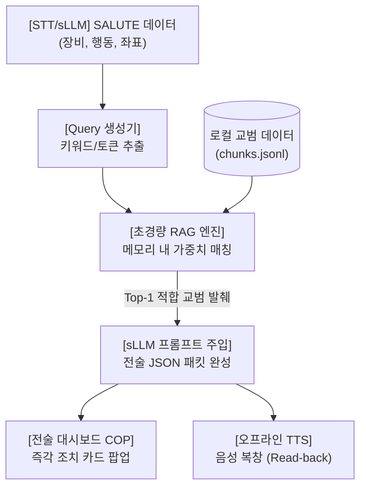

# [D4D T4-2 / SC1] 로컬 지식베이스(RAG) 구축 가이드

> **핵심 목표**: 인터넷이 완전히 차단된 전장 환경(SC1)에서 음성 무전(STT)으로부터 추출된 전술 정보(SALUTE)를 기반으로 군 교범(SOP/Battle Drill)을 실시간 검색(0.01초 이내)하여 지휘관에게 즉각 행동 지침 및 음성 복창문을 제공하는 체계 구축.

---

## 1. 아키텍처 및 데이터 흐름



---

## 2. 교범 청크 데이터 규격 (`data/chunks.jsonl`)

24시간 해커톤에서는 수백 페이지의 교범 전문을 넣는 대신, **시연 시나리오에 직결되는 핵심 소부대 즉각 조치(Battle Drill) 20~30개**를 정제하여 활용합니다.

### 2.1 스키마 명세
| 필드명 | 타입 | 설명 | 예시 |
| :--- | :--- | :--- | :--- |
| `id` | string | 교범/작전예규 식별 코드 | `"BD-04"` |
| `category` | string | 전술 유형 분류 | `"대기갑"`, `"대포병"`, `"화생방"` |
| `keywords` | string[] | 검색 트리거 키워드 목록 | `["전차", "T-72", "기갑", "장갑차"]` |
| `title` | string | 즉각 조치 공식 명칭 | `"대기갑 접촉 시 소부대 즉각 조치"` |
| `threat_level`| string | 기본 위협 등급 | `"CRITICAL"`, `"HIGH"`, `"MEDIUM"` |
| `immediate_actions` | string[] | 단계별 즉각 행동 수칙 3단계 | `["은폐 진지 점유", "취약부 조준", "화력 요청"]` |
| `read_back_template`| string | 지휘관 무전 복창용 1문장 요약 | `"적 기갑 출현, 은폐 진지 점유 및 화력 요청."` |

### 2.2 실전 교범 데이터셋 예시 (5대 핵심 시나리오)
```json
{"id": "BD-01", "category": "보병접촉", "keywords": ["저격", "소총", "단발", "저격수", "피격"], "title": "적 저격수 접촉 시 즉각 조치 (Battle Drill 1)", "threat_level": "HIGH", "immediate_actions": ["전원 즉시 가용한 엄폐물 뒤로 산개 및 은폐", "연막탄 투척으로 적 관측 및 사선 차단", "발사 음향/화염 원점 탐지 즉시 제압 사격 실시"], "read_back_template": "저격수 접촉, 차폐 연막 전개 및 원점 수색."}
{"id": "BD-04", "category": "대기갑", "keywords": ["전차", "장갑차", "T-72", "BMP", "기갑", "궤도"], "title": "대기갑 접촉 시 소부대 즉각 조치 (Battle Drill 4)", "threat_level": "CRITICAL", "immediate_actions": ["개활지 즉각 이탈 및 능선 이면 차폐 진지 점유", "대전차 미사일 사거리(400m) 내 유인 후 측·후면 취약부 타격", "대대 작전과에 포병 저지화력 유도 좌표 긴급 하달"], "read_back_template": "적 기갑 출현, 대전차 매복 진지 점유 및 포병 저지사격 요청."}
{"id": "BD-07", "category": "대포병", "keywords": ["포격", "낙탄", "박격포", "자주포", "포탄", "탄막"], "title": "적 간접화력(포격) 피격 시 생존 행동", "threat_level": "HIGH", "immediate_actions": ["초탄 낙탄 즉시 복벽을 지면에 밀착하여 포복", "사격 일시 중지 간을 이용하여 직각 방향 분산 대피", "대포병레이더 탄도 역추적 및 즉각 대응사격 요청"], "read_back_template": "적 간접포격 피격, 산개 대피 및 대포병 사격 요청."}
{"id": "BD-09", "category": "대공/드론", "keywords": ["드론", "무인기", "UAV", "정찰기", "자폭드론"], "title": "적 무인기/자폭 드론 식별 시 방호 조치", "threat_level": "HIGH", "immediate_actions": ["수목 하부 또는 위장망 내부로 신속 은폐", "휴대용 재머(안티드론건) 지향 및 전파 방해 가동", "육안 유효사거리 진입 시 소화기 대공 일제 사격"], "read_back_template": "적 드론 식별, 위장 은폐 및 안티드론 재밍 가동."}
{"id": "SOP-12", "category": "화생방", "keywords": ["화학탄", "가스", "연막", "오염", "독가스", "신경작용제"], "title": "화생방 경보 즉각 조치", "threat_level": "CRITICAL", "immediate_actions": ["경보 전파 즉시 호흡을 정지하고 9초 이내 방독면 착용", "보호의 착용 및 오염 노출 부위 제독 키트(KD-1) 도포", "풍상(바람이 불어오는 쪽) 고지대로 신속 이동"], "read_back_template": "화생방 경보 발령, 9초 내 방독면 착용 및 풍상 고지대 이탈."}
```

---

## 3. 온디바이스 초경량 RAG 엔진 구현 (`rag_engine.py`)

외부 패키지 설치 없이 표준 라이브러리만으로 메모리 내 0.001초 검색을 보장하는 엔진입니다.

```python
import json
from typing import List, Dict, Any

class TacticalRAGEngine:
    def __init__(self, jsonl_path: str = "data/chunks.jsonl"):
        self.chunks: List[Dict[str, Any]] = self._load_chunks(jsonl_path)

    def _load_chunks(self, path: str) -> List[Dict[str, Any]]:
        chunks = []
        with open(path, "r", encoding="utf-8") as f:
            for line in f:
                if line.strip():
                    chunks.append(json.loads(line.strip()))
        return chunks

    def retrieve(self, salute_data: Dict[str, Any], raw_text: str = "") -> Dict[str, Any]:
        """
        SALUTE 분석 결과와 STT 음성 텍스트를 조합하여 최적의 교범 1건 반환
        """
        equip = " ".join(salute_data.get("equipment", [])) if isinstance(salute_data.get("equipment"), list) else str(salute_data.get("equipment", ""))
        activity = str(salute_data.get("activity", ""))
        query = f"{raw_text} {equip} {activity}".lower()

        best_chunk = None
        max_score = 0.0

        for chunk in self.chunks:
            score = 0.0
            # 1. 키워드 일치 가중치 (3.0)
            for kw in chunk.get("keywords", []):
                if kw.lower() in query:
                    score += 3.0
            
            # 2. 카테고리 일치 가중치 (2.0)
            if chunk.get("category", "").lower() in query:
                score += 2.0
                
            # 3. 제목 단어 일치 가중치 (1.5)
            for word in chunk.get("title", "").split():
                if len(word) > 1 and word.lower() in query:
                    score += 1.5

            if score > max_score:
                max_score = score
                best_chunk = chunk

        # 매칭되는 교범이 없을 경우 기본값 반환
        return best_chunk if best_chunk else self.chunks[0]
```

---

## 4. sLLM 프롬프트 주입 및 출력 규격

검색된 교범 청크를 sLLM의 시스템 컨텍스트로 전달하여 환각 없이 표준 규격에 맞게 출력하도록 합니다.

### 4.1 프롬프트 템플릿
```text
당신은 통신 두절 전장에서 지휘관 결심을 보조하는 온디바이스 전술 작전 AI입니다.
반입된 [전술 무전]을 분석하고, 참조된 [참고 교범]의 즉각 조치 수칙을 엄격히 적용하여 JSON을 작성하십시오.

[참고 교범]
코드: {retrieved_sop['id']}
제목: {retrieved_sop['title']}
기본 조치: {retrieved_sop['immediate_actions']}

[전술 무전 원문]
"{raw_transcript}"

반드시 순수 JSON 형식으로만 응답하십시오 (마크다운 백틱 제외).
```

### 4.2 최종 전달 JSON 규격 (`sop_action` 포함)
```json
{
  "raw_transcript": "적 T-72 전차 2대 남쪽 도로에서 북쪽으로 기동 중, 좌표 384-912, 즉각 화력 지원 요망",
  "salute": {
    "size": "전차 2대",
    "activity": "도로 축선 따라 북쪽 방향 급속 전진 중",
    "location": { "grid": "384-912", "description": "남측 1번 국도 진입로" },
    "unit": "식별 불가 (적 기갑 추정)",
    "time": "현재 시각",
    "equipment": ["T-72 전차"]
  },
  "read_back_text": "적 T-72 전차 2대 북진 중, 화력 지원 요청 접수 완료.",
  "sop_action": {
    "code": "BD-04",
    "title": "대기갑 접촉 시 소부대 즉각 조치 (Battle Drill 4)",
    "immediate_actions": [
      "개활지 즉각 이탈 및 능선 이면 차폐 진지 점유",
      "대전차 미사일 사거리(400m) 내 유인 후 측·후면 취약부 타격",
      "대대 작전과에 포병 저지화력 유도 좌표 긴급 하달"
    ]
  }
}
```

---

## 5. 해커톤 파트별 진행 타임라인 (3h ~ 14h)

| 시간대 | 작업 내용 | 체크포인트 / 완료 기준 |
| :--- | :--- | :--- |
| **3h ~ 6h** | **교범 데이터 작성** | - `data/chunks.jsonl` 파일 생성 (핵심 시나리오 20~30개)<br/>- 군사 무전 용어사전 정비 |
| **6h ~ 10h** | **RAG 엔진 유닛 테스트** | - `rag_engine.py` 작성 및 독립 테스트 통과<br/>- 오프라인 키워드 매칭 정확도 100% 확인 |
| **10h ~ 14h** | **AI / UI 파이프라인 결합** | - STT + sLLM 파이프라인과 RAG 연결<br/>- 전체 검색 및 추론 지연 시간 50ms 미만 유지 |

---

## 6. 심사위원(피칭)용 핵심 세링 포인트

1. **지휘 결심 보조 체계(Actionable AI)**: 단순 STT 텍스트 변환에 그치지 않고, 적 식별 즉시 교범(Battle Drill) 기반의 행동 수칙을 군 지휘관에게 즉시 제안.
2. **Zero-Dependency & 완전 오프라인 (SC1)**: 무거운 벡터 DB나 외부 통신 없이 온디바이스 메모리에서 0.001초 내 검색 완료.
