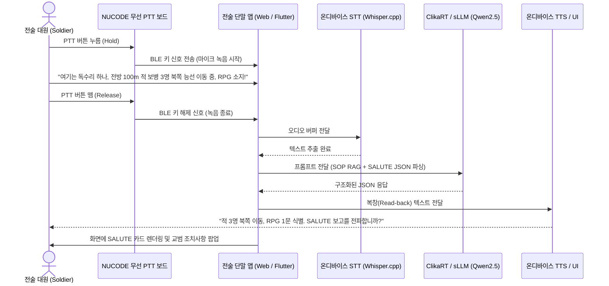

# T4-2 핸즈프리 음성 온디바이스 전술 AI 완주 가이드
> **Korean Defense Tech Hackathon 2026 (D4D × EDTH SEOUL)**  
> **트랙:** T4. Tactical Edge: Sensor Fusion & Edge AI (코요테 탄)  
> **과제:** T4-2 핸즈프리 음성 온디바이스 전술 AI (Voice-first Tactical AI)  
> **스페셜 챌린지:** SC1(CLIKA BYOD) + SC2(NUCODE Board)

---

## 1. 과제 개요 및 핵심 요구사항

### 1.1 문제 배경
* **페인포인트**: 전장의 병사는 손에 총기와 장비를 들고 있고 시선은 전방을 경계해야 하므로 키보드나 화면 터치 조작이 불가능합니다.
* **통신 한계**: 전파 침묵(EMCON) 및 적의 전자전(EW) 재밍 환경에서는 상급망과의 통신이 두절되므로, 외부 서버 없는 **100% 온디바이스 환경**에서 음성 처리가 완결되어야 합니다.
* **휘발성 정보**: 말이나 무전으로 오간 산발적 첩보와 명령은 기록/요약/정리되지 않고 유실됩니다.

### 1.2 핵심 개발 목표
손쉽게 구할 수 있는 음성 입력(스마트폰/노트북 마이크, 블루투스 이어셋 등)만으로 인터넷 연결 없이 작동하는 핸즈프리 전술 AI PMVP 개발:
1. **음성 질의응답**: 교범 및 작전예규(SOP) 기반 오프라인 질의응답
2. **상황 보고 자동 요약**: 무전 음성 발화를 핵심 위협/행동 중심으로 실시간 요약
3. **표준 보고 양식 자동 변환**: 음성 보고를 군 표준 양식(**SALUTE**, **SITREP**, **9-Line MEDEVAC**)으로 자동 구조화
4. **Read-back (되읽기/복창) UX**: 명령 및 보고 오인식을 방지하기 위한 음성 확인 절차

---

## 2. 스페셜 챌린지 (SC) 결합 요건 및 가산점 전략

### 2.1 SC1: CLIKA BYOD On-device AI Challenge (파트너: CLIKA)
* **제공 자원**: ClikaRT 플랫폼 접근권 및 엔지니어 멘토링
* **필수 요건**:
  1. ClikaRT를 활용하여 앱을 제작한 결과물
  2. **네트워크 완전 차단(비행기 탑승 모드 / 랜선 분리) 상태에서의 실동작 시연**
  3. GitHub 코드 저장소
* **우대 사항 (고득점 포인트)**: 동일한 모델/앱을 **두 종류 이상의 디바이스(예: 노트북 + 안드로이드 스마트폰)**에서 교차 구동 시 우대
* **부착 표시**: 트랙 피켓에 **초록색 형광 포스트잇** 부착

### 2.2 SC2: NUCODE Board Challenge (파트너: NUCODE)
* **제공 자원**: NUCODE 무선 개발보드 (BLE · Wi-Fi, 아두이노 IDE 호환), DAY 2 온보딩 세션
* **필수 요건**:
  1. 데모 시연에 **NUCODE 보드 1개 이상 실동작**
  2. **하드웨어 구성도(Architecture Diagram)** 제출
  3. GitHub 코드 저장소
* **우대 사항 (고득점 포인트)**: 다양한 디바이스(스위치, 센서 등)를 결합하여 손에 잡히는 창의적 국방 프로토타입 구현 시 우대
* **부착 표시**: 트랙 피켓에 **주황색 형광 포스트잇** 부착

---

## 3. 대회 운영 규칙 및 체크리스트 (B-1, B-3 시트)

* [ ] **피켓 세팅**: 팀 테이블 위에 **코요테 탄(T4)** 피켓 비치 + **초록 포스트잇(SC1)** + **주황 포스트잇(SC2)** 동시 부착 (1차 심사위원이 직접 방문)
* [ ] **NO SLIDES 원칙**: PPT 슬라이드 지양, 실제 하드웨어와 단말기에서 구동되는 **작동하는 결과물(PMVP)** 위주 평가
* [ ] **데이터 보안 준수**: 공개 데이터 및 합성(Synthetic) 데이터만 허용 (군사비밀, 수출통제, 개인정보 절대 금지)
* [ ] **플랫폼 등록**: [d4d.tech](https://d4d.tech) 사전 가입, 팀 빌딩 완료 및 기한 내 최종 제출

---

## 4. 필수 도메인 및 핵심 기술 스택

### 4.1 군 표준 전술 보고 양식

| 보고 양식 | 구성 요소 | 설명 및 구현 목표 |
| :--- | :--- | :--- |
| **SALUTE 보고** | **S**ize (적 규모)<br/>**A**ctivity (적 활동/기동방향)<br/>**L**ocation (위치/좌표, MGRS)<br/>**U**nit (적 소속/복장/식별)<br/>**T**ime (발견 일시)<br/>**E**quipment (장비/화기) | 구두로 발화된 적 첩보를 AI가 즉시 6개 필드로 분해하여 구조화된 데이터로 변환 |
| **SITREP** | 아군 위치, 탄약/보급 잔여량, 부상자 현황, 작전 상황 | 소부대 지휘관이 정기적으로 상급 부대에 보고하는 상황 요약 양식 |
| **9-Line MEDEVAC** | 1.위치 / 2.주파수 / 3.환자수·긴급도 / 4.특수장비 / 5.환자유형 / 6.보안 / 7.표식 / 8.국적 / 9.CBRN | 응급 의무 후송 요청을 9개 표준 라인으로 신속 구조화 |

### 4.2 온디바이스 음성 AI (STT & TTS)
* **STT 엔진**: `Whisper.cpp` 또는 `Sherpa-ONNX` (추천: `whisper-tiny` 또는 `whisper-base` 다국어 모델)
* **무전 최적화**: 
  * `Silero VAD`로 침묵 구간 차단 및 발화 구간 자동 추출
  * Whisper `initial_prompt`에 군사 용어(SALUTE, 좌표, 적 전차, 오버 등)를 주입해 인식률 극대화
* **TTS 엔진 (복창/Read-back용)**: 경량 `Piper TTS` 또는 브라우저/OS 내장 오프라인 음성 합성 API

### 4.3 온디바이스 sLLM & 로컬 RAG
* **추천 경량 모델 (1B~3B)**: `Qwen-2.5-1.5B/3B-Instruct`, `Llama-3.2-1B/3B`, `Gemma-2-2B` (4-bit 양자화 GGUF)
* **로컬 RAG**: 보병 교범, 적 접촉 시 즉각 조치(Battle Drill)를 `chunks.jsonl`로 패키징 후 로컬 키워드/임베딩 검색
* **구조화 출력 프롬프트**: 아래와 같이 엄격한 JSON 스키마를 강제
```json
{
  "report_type": "SALUTE",
  "data": {
    "size": "적 보병 3명",
    "activity": "북쪽 능선 방향 도보 이동 중",
    "location": "좌표 52S DH 1234 5678",
    "unit": "식별 불가 (위장복 착용)",
    "time": "10:30 경",
    "equipment": "소총 3정, RPG 추정 화기 1문"
  },
  "read_back_text": "적 3명 북쪽 이동 중, RPG 1문 식별. SALUTE 보고를 전파합니까?",
  "recommended_action": "교범 제3장: 아군 엄폐 후 정밀 관측 유지 및 화력 유도 준비"
}
```

### 4.4 NUCODE 보드 하드웨어 (무선 전술 PTT)
* **보드 역할**: 손가락/장구류 장착형 웨어러블 무선 Push-to-Talk 버튼
* **통신 구현**: 아두이노 `BleKeyboard` 라이브러리로 BLE HID 모드 구성 (버튼 누름 시 `Space` 또는 `F13` 전송)
* **하드웨어 구성도**:
```
[전술 장갑 / 총기 레일]           [NUCODE 개발보드]                     [전술 단말기 (Laptop/Phone)]
 [택트 스위치 (PTT 버튼)] ---> [ESP32 / GPIO 인터럽트] 
 [상태 LED (송신 표시)]   <--- [GPIO 상태 출력] 
                                    [BLE HID 무선 연결] ========> [블루투스 수신]
                                                                        ↓
                                                                [마이크 수음 활성화 & AI 엔진]
```

---

## 5. 전체 시스템 아키텍처 및 동작 시퀀스



---

## 6. 쇼케이스 벤치마크 및 레퍼런스

* **On-Device Tactical AI** (1페이지): Flutter + `flutter_gemma` + 로컬 RAG(`chunks.jsonl`)를 활용한 상황 카드 기반 전술 질의응답 프로토타입. [GitHub (hojun-jo/on-device-tactical-ai)](https://github.com/hojun-jo/on-device-tactical-ai)
* **Nyx: 통신·GPS 두절 환경을 위한 온디바이스 AI 인터페이스** (2페이지, **수상작**): 통신 두절 환경에서 대원의 인지부하를 최소화하는 온디바이스 상황 인식 인터페이스. [GitHub (neomakes/nyx)](https://github.com/neomakes/nyx)
* **AI4CE** (4페이지): 군사 교범 및 작전 절차를 사전 RAG화하여 폐쇄망 단말에서 지휘결심을 보조하는 시스템.
* **Gray-Zone Watcher** (4페이지): ESP32 무선 노드를 활용해 하드웨어와 C2 대시보드를 연동한 프로토타입. [GitHub (0304minjae/d4d)](https://github.com/0304minjae/d4d)

---

## 7. 24시간 단계별 액션 플랜 (Action Plan)

### 1단계: 세팅 & 사전 준비 (0h ~ 3h)
- [ ] 테이블에 **코요테 탄(T4) 피켓** 비치 및 **초록 포스트잇(SC1)**, **주황 포스트잇(SC2)** 부착
- [ ] 인터넷 차단 대비 모델 가중치(`whisper`, `qwen2.5-1.5b-gguf`) 및 라이브러리 오프라인 다운로드
- [ ] 팀원 역할 분담 (AI/ClikaRT 1명, HW/NUCODE 1명, Front/UI 1명, 전술 기획/RAG 1명)

### 2단계: 파트별 병렬 개발 (3h ~ 14h)
- [ ] **[HW]** NUCODE 보드에 스위치 배선, `BleKeyboard` 펌웨어 업로드, 하드웨어 구성도 다이어그램 작성
- [ ] **[AI]** 온디바이스 STT 오프라인 파이프라인 구축 및 군사 용어 바이어싱 적용
- [ ] **[AI]** ClikaRT 환경에 경량 LLM 배포 및 SALUTE/SITREP JSON 변환 프롬프트 튜닝
- [ ] **[UI]** PTT 키보드 이벤트 리스닝 연동, 실시간 오디오 파형 및 SALUTE 카드 컴포넌트 개발
- [ ] **[도메인]** 전술 교범/SOP 즉각 조치사항 20개 청크 작성 및 로컬 RAG 색인

### 3단계: 전체 통합 및 멀티 디바이스 최적화 (14h ~ 18h)
- [ ] NUCODE 보드 PTT 누름 → 마이크 수음 → STT → LLM → Read-back TTS 통합 테스트
- [ ] 노트북 브라우저뿐만 아니라 **안드로이드 스마트폰(BYOD)**에서도 구동 검증 (SC1 우대 점수 확보)

### 4단계: 오프라인 검증, 제출, 발표 준비 (18h ~ 24h)
- [ ] **네트워크 차단(비행기 탑승 모드)** 상태에서 100% 정상 작동 리허설 3회 실시
- [ ] [d4d.tech](https://d4d.tech) 플랫폼에 프로젝트 소개, GitHub 링크, **하드웨어 구성도** 업로드
- [ ] NO SLIDES 원칙에 맞춘 **3분 실동작 현장 피칭 대본** 최종 리허설

---

## 8. 심사위원(NO SLIDES) 현장 3분 시연 피칭 대본

1. **상황 제시 (30초)**:  
   *"심사위원님, 전장의 병사는 양손에 총기를 들고 전방을 경계해야 하므로 키보드를 칠 수 없습니다. 저희는 통신이 완전히 두절된 전장에서도 음성만으로 전술 보고를 완결하는 온디바이스 전술 AI를 구축했습니다."*
2. **오프라인 환경 증명 (30초 - SC1 충족)**:  
   *"보시다시피 현재 노트북과 스마트폰 모두 와이파이가 꺼진 비행기 탑승 모드이며, 외부 서버 연결 없이 100% 로컬 ClikaRT 위에서 구동됩니다."*
3. **하드웨어 실동작 시연 (1분 - SC2 충족)**:  
   *(손가락에 장착된 NUCODE 보드 PTT 버튼을 누르며 무전 발화)*  
   *"여기는 1분대, 10시 방향 능선에서 적 무장병력 3명 북쪽 이동 중, RPG 소지!"*  
   *(버튼을 떼자마자 1~2초 내에 화면에 STT 변환 텍스트 출력)*
4. **결과 확인 및 복창 (1분)**:  
   * AI가 음성으로 되읽음: *"적 3명 북쪽 이동, RPG 1문 식별. SALUTE 보고를 전파합니까?"*  
   * 화면에 정형화된 **SALUTE 보고서 카드**와 **대기갑 교범 즉각 조치사항** 팝업 시현.  
   * 스마트폰 화면에서도 동일하게 연동됨을 보여주며 BYOD 완성도 강조.
