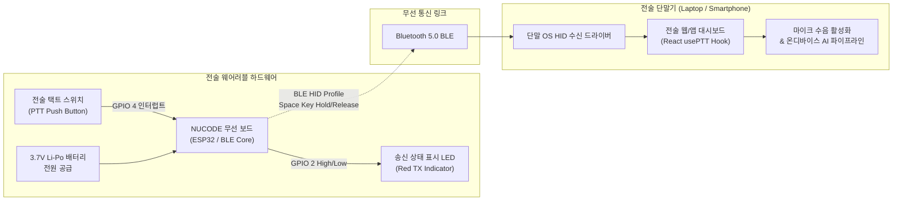

# NUCODE 무선 전술 PTT 보드 (SC2 챌린지)

> **Korean Defense Tech Hackathon 2026**  
> **스페셜 챌린지 2:** NUCODE Board Challenge (파트너: NUCODE)

---

## 1. 하드웨어 개요 및 역할
* **역할**: 전술 대원의 장구류(방탄조끼 몰리 규격) 또는 총기 피카티니 레일에 결속 가능한 **무선 전술 Push-to-Talk (PTT) 버튼**.
* **통신 프로토콜**: **Bluetooth Low Energy (BLE) HID Keyboard** 프로토콜.
* **장점**: 별도의 수신 드라이버나 전용 수신기 없이, 단말기(노트북, 안드로이드 스마트폰)의 OS 기본 블루투스 키보드로 즉시 페어링되어 키 입력을 전송.

---

## 2. 하드웨어 아키텍처 다이어그램 (Architecture Diagram) - SC2 필수 제출물

---

## 3. 핀 결선도 (Pin Wiring)

| 부품 | NUCODE 보드 핀 | 결선 방식 / 설명 |
| :--- | :--- | :--- |
| **택트 스위치 (PTT 버튼)** | `GPIO 4` & `GND` | 내부 풀업(INPUT_PULLUP) 사용. 누르면 LOW, 떼면 HIGH |
| **상태 표시 LED (+) 극** | `GPIO 2` | 220Ω 저항 경유 후 연결 (송신 중 점등) |
| **상태 표시 LED (-) 극** | `GND` | 공통 접지 |
| **전원 공급** | `3V3` / `GND` | 보드 내장 배터리 포트 또는 USB 5V |

---

## 4. 아두이노 IDE 빌드 및 업로드 방법

1. **라이브러리 설치**:
   * 아두이노 IDE `툴` > `라이브러리 관리`에서 `ESP32-BLE-Keyboard` 설치.
2. **보드 선택**:
   * `ESP32 Dev Module` (또는 NUCODE 제공 보드 정의) 선택.
3. **업로드**:
   * `nucode_ptt.ino` 파일을 열고 포트 지정 후 업로드.
4. **블루투스 페어링**:
   * 노트북 또는 안드로이드 스마트폰의 블루투스 설정에서 **`NUCODE-PTT-EAGLE1`** 검색 후 연결.
   * 페어링 완료 후 버튼을 누르면 단말기에서 스페이스바 키가 입력되며 전술 웹 UI의 마이크 수음이 즉시 활성화됩니다.
